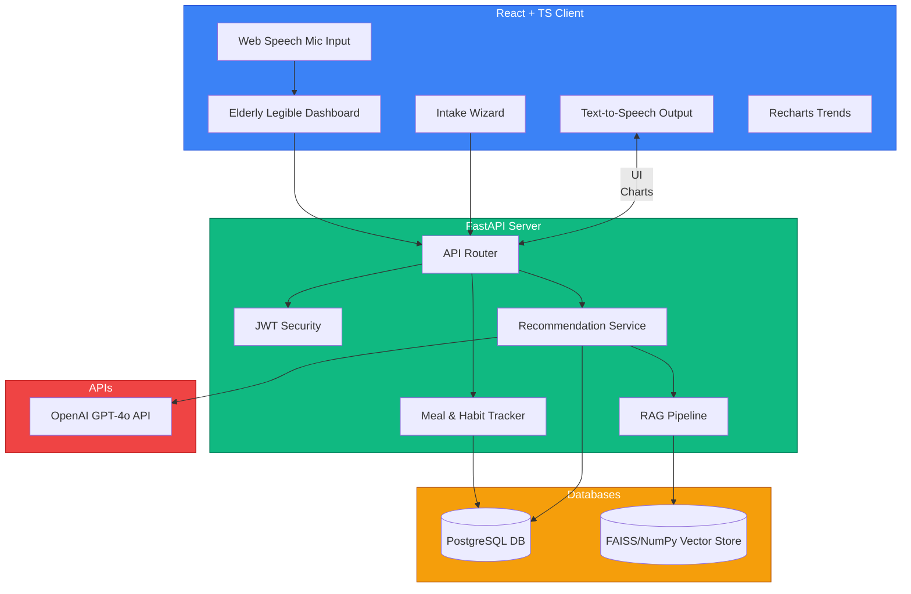
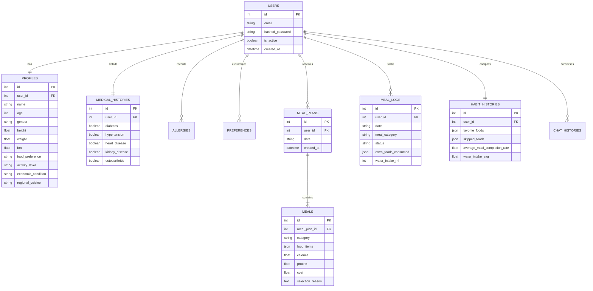

# NutriMind AI: A Personalized RAG-Based Diet Planning Assistant for Elderly Healthcare

NutriMind AI is an intelligent healthcare assistant designed to generate personalized daily diet recommendations for elderly individuals. Rather than generating static meal plans, it continuously adapts its recommendations based on user demographics, chronic medical conditions, allergies, physical habits, economic status, regional preferences, and daily meal tracking logs.

---

## 🌟 Key Features

1. **Multi-Step Elderly Onboarding (Intake Wizard)**: Gathers comprehensive demographics, activity metrics, chronic conditions, and economic/cuisine preferences.
2. **Clinical Safety Constraints**: Guarantees diets conform to medical rules (e.g. restricts high sodium for hypertension, high GI sugars for diabetes, protein for kidney disease).
3. **Retrieval-Augmented Generation (RAG)**: Ingests clinical guidelines from WHO and ICMR, retrieving relevant medical chunks to ground LLM advice.
4. **Adaptive Compensation Engine**: Compensates diet plans dynamically (e.g. increases nutrients for skipped breakfast, drops sugar for dinner if extra sweets were logged).
5. **Elderly-Centric Accessibility**: Large typography, clean spacing, integrated text-to-speech plan readers, and microphone dictation for logging extra food.
6. **Caregiver Mode & Exports**: Enables family/caregivers to inspect diet logs, view nutrition graphs, and export text summaries for doctor reviews.

---

## 📐 Architecture & System Flow



---

## 🗄️ Database Entity-Relationship (ER) Diagram



---

## 🔌 Core API Endpoints

| Method | Endpoint | Description | Auth Required |
| :--- | :--- | :--- | :--- |
| **POST** | `/api/v1/auth/register` | Register a new user/caregiver account | No |
| **POST** | `/api/v1/auth/login` | Login and obtain JWT access token | No |
| **GET** | `/api/v1/profile/me` | Retrieve current user profile | Yes |
| **POST** | `/api/v1/profile/me` | Create or update user profile (Auto BMI) | Yes |
| **GET** | `/api/v1/profile/medical-history` | Fetch medical disease flags | Yes |
| **POST** | `/api/v1/profile/medical-history`| Update chronic medical conditions | Yes |
| **POST** | `/api/v1/profile/allergies` | Set list of food allergies | Yes |
| **POST** | `/api/v1/profile/preferences` | Set likes/dislikes food preferences | Yes |
| **GET** | `/api/v1/planner/generate-plan` | Fetch/generate meal plan for date | Yes |
| **POST** | `/api/v1/tracker/log-meal` | Log completion status (Full/Half/Skip) | Yes |
| **POST** | `/api/v1/tracker/water` | Log fluid consumption | Yes |
| **POST** | `/api/v1/chat` | Query dietician chatbot (RAG Q&A) | Yes |
| **GET** | `/api/v1/dashboard` | Fetch BMI, today's targets, weekly logs | Yes |
| **GET** | `/api/v1/dashboard/habits` | Fetch learned eating habits stats | Yes |

---

## 🛠️ Local Installation & Development

### 1. Backend Setup
1. Move to the `backend/` directory:
   ```bash
   cd backend
   ```
2. Create a virtual environment and activate it:
   ```bash
   python3 -m venv venv
   source venv/bin/activate
   ```
3. Install dependencies:
   ```bash
   pip install -r requirements.txt
   ```
4. Configure configurations:
   - Copy `.env.example` to `.env`
   - Fill in your `OPENAI_API_KEY` (Optional. If blank, it falls back to the clinical rules engine).
5. Start the server:
   ```bash
   uvicorn app.main:app --reload --port 8000
   ```
   - API Docs will be live at: [http://localhost:8000/docs](http://localhost:8000/docs)

### 2. Frontend Setup
1. Move to the `frontend/` directory:
   ```bash
   cd ../frontend
   ```
2. Install dependencies:
   ```bash
   npm install
   ```
3. Start the Vite server:
   ```bash
   npm run dev
   ```
   - The application will be live at: [http://localhost:3000](http://localhost:3000)

---

## 🐳 Containerized Deployment (Docker)

You can launch the entire ecosystem (Postgres + FastAPI + React) in one command:

1. Ensure Docker and Docker Compose are running.
2. Build and launch:
   ```bash
   docker-compose up --build
   ```
3. Connect:
   - Client Portal: [http://localhost:3000](http://localhost:3000)
   - API Router: [http://localhost:8000](http://localhost:8000)
